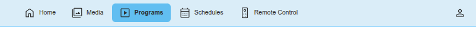
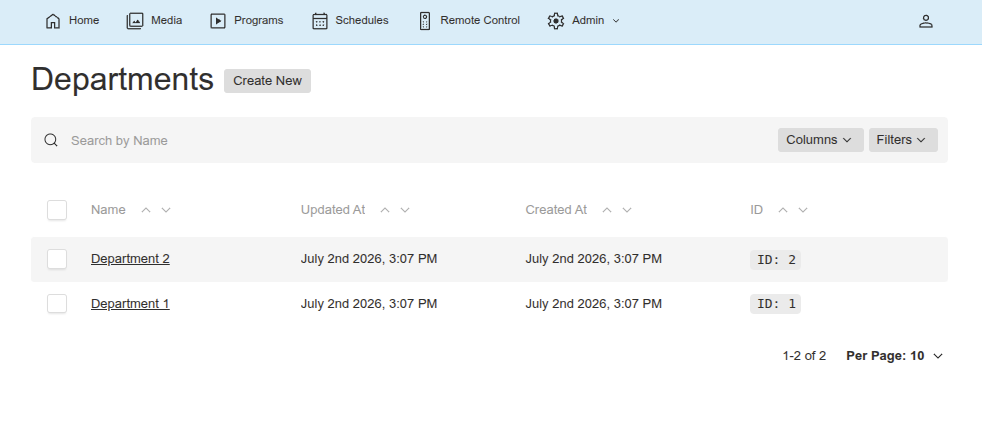
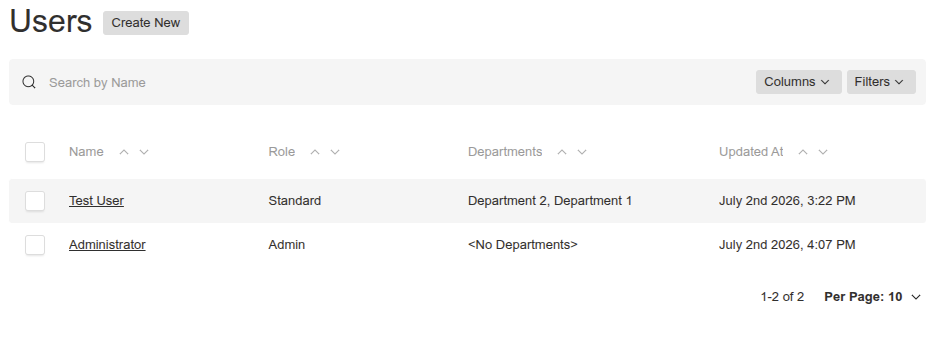
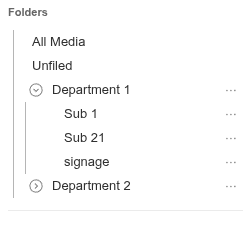
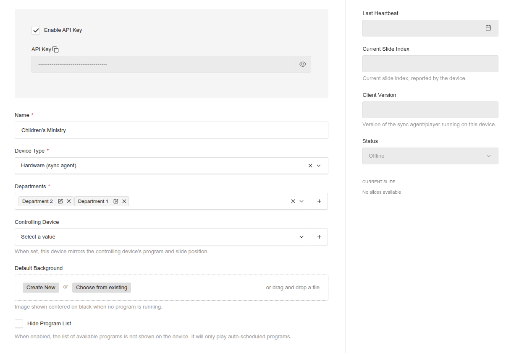
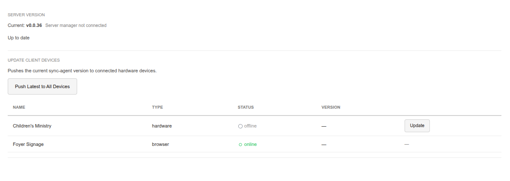
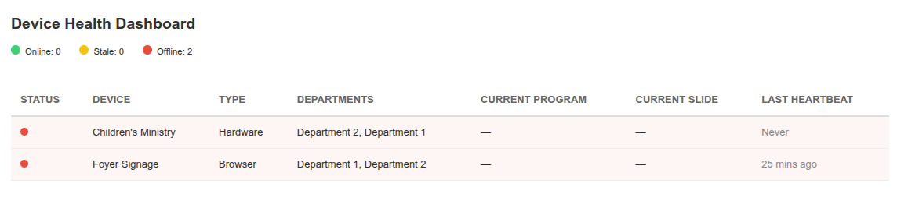

# PeydX — Church Education & Presentation System: Administrator Guide

## Table of Contents

1. [System Overview](#system-overview)
2. [Navigation](#navigation)
3. [User Workflows](#user-workflows)
4. [Managing Departments](#managing-departments)
5. [Managing Users](#managing-users)
6. [Managing Folders](#managing-folders)
7. [Managing Devices](#managing-devices)
8. [Integrations](#integrations)
9. [Updates](#updates)
10. [Health Dashboard](#health-dashboard)

---

## System Overview

PeydX is a church education and presentation system for managing classroom content, children's ministry lessons, and digital signage displayed on screens throughout your church campus. It consists of three main parts:

- **CMS Backend** — The web-based content management system where you upload media, create programs, schedule content, and monitor devices.
- **Players** — Hardware devices (sync agents) or browser screens that run your programs in classrooms, worship spaces, and lobby displays.
- **Sync Agent** — A background process that runs on hardware players to download media and schedules from the CMS.

### How Departments Work

Everything in the system is scoped by **departments**. A department represents a ministry or area (e.g., "Youth Ministry", "Worship Team", "Main Auditorium"). Each department has its own:

- **Folders** — Root media and programs folders are created automatically when a department is created.
- **Media** — Uploaded files belong to a department's folders.
- **Programs** — Slide programs belong to a department's folders.
- **Schedules** — The department is automatically inferred from the selected program.
- **Devices** — Devices are assigned to one or more departments.
- **Users** — Users can belong to multiple departments and see data from all of them.

### User Roles

| Capability | Admin | Manager | Standard |
|---|---|---|---|
| See all departments' data | Yes | No — only their own departments | No — only their own departments |
| Create/edit/delete users | Yes | Create/edit/delete Standard users in their departments | No |
| Create/edit/delete devices | Yes | No | No |
| Create/edit/delete departments | Yes | No | No |
| Create/edit/delete folders | Yes (folder must be empty) | Create/edit/delete in their departments (folder must be empty) | Create/edit/delete in their departments (folder must be empty) |
| Upload and manage media | Yes | Within their departments | Within their departments |
| Create and edit programs | Yes | Within their departments | Within their departments |
| Delete programs | Yes | Within their departments | Within their departments |
| Create and edit schedules | Yes | Within their departments | Within their departments |
| Delete schedules | Yes | Within their departments | Within their departments |
| Access Integrations and Updates | Yes | No | No |
| Push software updates | Yes | No | No |
| Use Remote Control | Yes | Yes (devices in their departments) | Yes (devices in their departments) |

---

## Navigation



Day-to-day navigation is shared by all users and is documented in the [User Guide](../guides/user-guide.md#navigation). As an admin you additionally see an **Admin** dropdown in the top-right, with these text-only items (no icons):

| Item | Description |
|---|---|
| **Departments** | Create, edit, and delete departments (each gets root media and programs folders) |
| **Folders** | Browse and manage all folders across departments |
| **Users** | Create, edit, and delete user accounts |
| **Devices** | Create, edit, and delete devices |
| **Integrations** | Manage API keys for external systems |
| **Updates** | Deploy server versions and push software updates to devices |
| **Device Health Dashboard** | Live status of all devices |

The **Account** menu (person icon) lets any user change their name, email, or password.

---

## User Workflows

Most day-to-day tasks are the same for every role and are documented in the [User Guide](../guides/user-guide.md). Use those as the primary references and share them with your users:

| Topic | Where to find it |
|---|---|
| Dashboard | [User Guide — Dashboard](../guides/user-guide.md#dashboard) |
| Uploading & organizing media (folders, YouTube import, PowerPoint/PDF import) | [User Guide — Upload & Organize Media](../guides/user-guide.md#upload--organize-media) |
| Creating and editing programs | [User Guide — Create & Edit Programs](../guides/user-guide.md#create--edit-programs) |
| Scheduling programs on devices (calendar view, priorities, recurring) | [User Guide — Schedule Programs to Devices](../guides/user-guide.md#schedule-programs-to-devices) |
| Remote Control | [User Guide — Remote Control](../guides/user-guide.md#remote-control) |
| Changing your password | [User Guide — Changing Your Password](../guides/user-guide.md#changing-your-password) |

---

## Managing Departments



Departments are the top-level organizational unit. They scope all content in the system.

### Creating a Department

1. Navigate to **Admin > Departments** in the top navigation.
2. Click **Create**.
3. Enter the **Name** (e.g., "Youth Ministry", "Worship Team").
4. Click **Save**.

When you create a department, the system automatically creates two root folders:
- A **media** root folder (for organizing uploaded files)
- A **programs** root folder (for organizing slide programs)

### Editing a Department

1. Click on a department in the list.
2. Update the name.
3. Click **Save**.

**Note:** Renaming a department does not rename its root folders — you may want to update those manually.

### Deleting a Department

Only admins can delete departments. Deleting a department that has associated users, folders, media, programs, schedules, or devices will fail — you must reassign or remove those items first.

---

## Managing Users



Only admins can create, edit, or delete user accounts.

### Creating a User

1. Navigate to **Admin > Users** in the top navigation.
2. Click **Create**.
3. Fill in the fields:
   - **Email** — The user's login email address
   - **Name** — The user's display name
   - **Password** — Set an initial password
   - **Role** — Choose Admin, Manager, or Standard
   - **Departments** — Select one or more departments (shown in sidebar, admin-only field)
4. Click **Save**.

### Understanding Roles

- **Admin** — Full access to everything. Can manage users, devices, departments, integrations, and settings. Can delete programs and schedules. Sees the Admin dropdown in navigation.
- **Manager** — Can create, edit, and delete Standard users within their departments. Can assign users to departments they belong to. Has all the content permissions of a Standard user. Cannot manage admins, managers, devices, departments, or settings.
- **Standard** — Can create, edit, and delete all content in their assigned departments (media, programs, schedules, folders). Cannot manage users or devices. Cannot access admin sections.

### Multi-Department Users

A user can be assigned to multiple departments. They will see and manage content from all their departments. For example, a user in both "Youth Ministry" and "Worship Team" can create programs that use media from either department.

### Editing a User

1. Click on a user in the list.
2. Update their name, role, or departments.
3. To reset their password, use the "Password" field in the sidebar.
4. Click **Save**.

---

## Managing Folders



Folder management — creating, renaming, deleting folders, and the folder sidebar — is a shared capability documented in the [User Guide](../guides/user-guide.md#upload--organize-media) (see "Organizing Media into Folders"). This section covers the admin-specific notes.

- Root **media** and **programs** folders are created automatically when a department is created. Non-admin users cannot create root-level folders — they create sub-folders only.
- The **All Media** / **All Programs** and **Unfiled** entries at the top of the folder tree are admin-only views: **All** shows every item across all departments, and **Unfiled** shows items not assigned to any folder.
- Folders nest up to **3 levels deep**. Deleting a folder requires it to be empty (no sub-folders, media, or programs inside).

---

## Managing Devices



Devices represent the physical screens or browsers that display your content. Only admins can create or delete devices.

### Device Types

| Type | Description |
|---|---|
| **Hardware (sync agent)** | A physical device running the sync agent. Connects via API key for authentication. Downloads media and schedules locally. |
| **Browser (direct URL)** | A web browser pointed at a special URL. Connects directly to the CMS via a browser token. No local storage required. |

### Creating a Device

1. Navigate to **Admin > Devices**.
2. Click **Create**.
3. Fill in the fields:
   - **Name** — A descriptive name (e.g., "Lobby Screen", "Youth Room TV")
   - **Device Type** — Hardware or Browser
   - **Departments** — Select which departments this device belongs to. This controls which programs and schedules the device can access.
4. Configure optional settings:
   - **Controlling Device** — Set this to make the device mirror another device's program and slide position. Only one level of mirroring is allowed (no chains).
   - **Default Background** — Upload an image to display (centered on black) when no program is running.
   - **Hide Program List** — Check this to prevent the manual program selection menu from appearing on the device. The device will only play auto-scheduled programs.
5. Click **Save**.

### Browser Device URLs

For browser-type devices, the system auto-generates a **browser token**. When viewing a browser device, you'll see:

- **Browser Token** — A read-only UUID used for authentication.
- **Copy URL** / **Open in New Tab** — A custom URL in the format `/device/{id}?token={browserToken}` that you can share or bookmark.

### Device Status (Read-Only Sidebar)

| Field | Description |
|---|---|
| Last Heartbeat | Timestamp of the device's most recent check-in |
| Current Program | The program currently playing on the device |
| Current Slide Index | Which slide the device is showing |
| Status | Online, Offline, or Stale |
| Current Slide | Visual indicator showing current slide thumbnail |

Status values:
- **Online** — Device is actively checking in
- **Stale** — Device has checked in but may be behind
- **Offline** — Device has not checked in recently

### Mirroring (Controlling Device)

A device can be set to mirror another device. When configured:
- The mirror device plays the same program as the controlling device.
- The mirror device stays on the same slide as the controlling device.
- Only one level of mirroring is supported — you cannot chain mirrors (Device A controls Device B which controls Device C).
- When the controlling device's program or slide changes, the mirror updates in real-time via WebSocket.

> [!NOTE]
> This works by essentially sending the same command to both devices, so timing on each device may not be exact. Don't expect the video to be synced to the frame.

### Pushing Updates

Admins can push software updates to devices:

- **Single device**: On the **Updates** page, find the device in the "Update Client Devices" table and click its **Update** button. The device will download and install the latest player version.
- **All devices**: On the **Updates** page, click **Push Latest to All Devices** to update every connected device at once.

Devices with type "Hardware (sync agent)" receive the update; browser devices update automatically via version polling.

---

## Integrations

Integrations are API key credentials for external systems (e.g., Home Assistant, custom scripts) that need to interact with the PeydX API.

### Creating an Integration

1. Navigate to **Admin > Integrations**.
2. Click **Create**.
3. Fill in:
   - **Name** — Descriptive name (e.g., "Home Assistant", "Monitoring Script")
   - **Expires At** — When the API key expires
   - **Departments** — Optional. Restricts the key's access to specific departments. Leave empty for access to all departments.
4. Click **Save**.
5. Copy the generated API key — it will only be shown once.

### Using an API Key

Auth header format: `Authorization: integrations API-Key <key>`

Example:
```
Authorization: integrations API-Key eyJhbGciOiJIUzI1NiIsInR5cCI6IkpXVCJ9...
```

If departments are set on the integration, API calls will be scoped to only those departments. If no departments are set, the key has access to all departments' data.

---

## Updates



The Updates page (in the Admin dropdown) is admin-only and manages deployment versioning.

### Server Version

The page shows the current server version and the latest available version (fetched from the server manager).

### Deploying a Server Update

- **Deploy {version}** — Triggers a server self-update. A full-screen overlay shows four progress steps (checking out version, building client image, pushing to registry, rebuilding server) and auto-refreshes when complete.

### Updating Client Devices

The page includes a device table showing each device's Name, Type, Status, and current software Version:

- **Push Latest to All Devices** — Sends the current client version to all connected hardware devices, triggering them to pull the updated image and restart.
- **Per-device Update** — Each hardware device row has an **Update** button to update it individually. Browser devices on this page update automatically via version polling.

---

## Health Dashboard

An admin-only page showing live status of all devices, with summary counters at the top (e.g. "Online: 3 / Stale: 1 / Offline: 0"). Navigate via **Admin > Device Health Dashboard** in the top navigation bar.



Device status and current programs update in real time via WebSocket — no page refresh needed.

| Column | Description |
|---|---|
| Status | Colored dot (green = online, amber = stale, red = offline) |
| Device | Device name |
| Type | Hardware or Browser |
| Departments | Which departments the device belongs to (department names) |
| Current Program | What's currently playing |
| Current Slide | Current slide thumbnail |
| Last Heartbeat | Timestamp of last check-in |